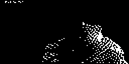

<div align="center">

# 🦇 Batman x Sajan Sajan — on a 0.96" OLED
### The edit that's all over Shorts and Reels, playing at **30 fps** on a screen the size of a postage stamp.



**768 frames. One ESP8266. Zero audio. The Dark Knight, but make it a wedding song.**

> **Built and tested on ESP8266.** Want it on a different board? [Open OLED Animation Maker](https://www.oledanimationmaker.com/), pick your board and library, import your clip and click **Get the Code**.


[**⬇ Get the code**](#-60-second-start) · [**📖 Full tutorial**](https://www.oledanimationmaker.com/blog/sajan-sajan-batman-edit-oled-animation-esp8266-ssd1306.html) · [**💍 Original version**](https://github.com/itzmeAshish/SajanSajan) · [**🛠 Make your own**](https://www.oledanimationmaker.com/) · [**📸 Instagram**](https://www.instagram.com/oled_animator)

</div>

---

## Why this exists

Batman footage cut to **Sajan Sajan Teri Dulhan Tujhko Pukare Aaja** is one of the most-shared edit formats on Shorts and Reels right now. A brooding vigilante, a wedding-season melody, and somehow it works.

This repo takes that edit and plays it as **real 1-bit video** on a **0.96" SSD1306** (128×64). Not a loop of drawings: dithered footage, 30 frames a second, with a live FPS readout on Serial.

Put it on your desk. Film it for a reel. Show it to the one friend who keeps sending you the original.

> 🔇 Pictures only. The sketch has no speaker. Play the song from your phone and let the OLED do the visuals.

Want the pixel-art love-story version instead? → **[SajanSajan](https://github.com/itzmeAshish/SajanSajan)** (338 frames, any ESP board).

---

## What you get

| | |
|---|---|
| 🎞 **Frames** | 768 × 128×64 mono bitmaps in `PROGMEM` (`frame_000` … `frame_767`) |
| ⏱ **Speed** | Target **30 fps** (`TARGET_FPS`), a timed player with a 33,333 µs frame period |
| 🔁 **Loop** | **25.6 seconds**, then it restarts |
| 📈 **Live stats** | Serial at 115200 prints render time and actual FPS every second |
| 🧪 **Test mode** | `TEST_MODE true` plays only the first 24 frames (~1 s) |
| 🚀 **I2C** | 400 kHz fast mode, set in `setup()` |
| 📚 **Libraries** | Adafruit SSD1306 + Adafruit GFX |

Repo layout:

```
SajanSajanBatmanVersion/
└── oledanimationmakerBatman/
    ├── OLEDVideo_Video_87597.ino   ← the player
    └── frames.h                    ← all 768 frames (~5 MB of source)
```

---

## 🔁 Need a different board?

All the code here is made for **ESP8266**. Please don't hand-edit it for another chip. Instead, generate fresh code for your board on our website:

1. Open [oledanimationmaker.com](https://www.oledanimationmaker.com/)
2. Pick your **board** (the tool has a 24-board menu: Arduino Uno/Nano/Mega, many ESP32 types, Raspberry Pi Pico and more) and your **library**
3. Import your clip or GIF
4. Click **Get the Code** and upload it

---

## ⚡ 60-second start

```bash
git clone https://github.com/itzmeAshish/SajanSajanBatmanVersion.git
```

1. Rename the **`oledanimationmakerBatman`** folder to **`OLEDVideo_Video_87597`** (Arduino IDE needs the folder name to match the `.ino`)
2. Install the **ESP8266** board package, plus **Adafruit SSD1306** and **Adafruit GFX**
3. Select your ESP8266 board and a **4MB flash** layout
4. Upload (the first compile is slow, since `frames.h` is about 5 MB)
5. Open Serial at **115200** and watch for `Actual FPS: 30.0 Hz`

> **New to Arduino?** The [step-by-step upload guide](https://www.oledanimationmaker.com/blog/upload-oled-animation-from-github-esp8266-arduino-ide.html) covers the board package, wiring diagram, board settings and a troubleshooting table.

---

## Requirements

| Item | Notes |
|------|--------|
| Board | **ESP8266** (NodeMCU or Wemos D1 Mini) with **4MB flash** |
| OLED | 0.96" SSD1306 I2C 128×64 @ `0x3C` |
| IDE | Arduino IDE 1.8+ or 2.x |
| Wires | 4 Dupont jumpers |

> **Will it run on an Uno, Nano or Mega?** No. 768 frames × 1024 bytes = **786,432 bytes (768 KB)** of pictures alone.
> Uno has 32 KB of flash and Mega 2560 has 256 KB.
>
> **Flash tip:** 768 KB of frames plus the core and libraries lands near the ~1 MB limit of the common 4MB layouts. If the IDE says the sketch is too big, choose a 4MB layout with a larger sketch partition, or re-export fewer frames.

---

## 🔌 Wiring

| OLED | ESP8266 | GPIO |
|------|--------|------|
| VCC | **3.3V** | — |
| GND | GND | — |
| SDA | **D2** | GPIO4 |
| SCL | **D1** | GPIO5 |

These match `I2C_SDA 4` and `I2C_SCL 5` in the sketch.

**Another board?** This code is built for ESP8266 only. For any other board, generate code for it on [oledanimationmaker.com](https://www.oledanimationmaker.com/).

---

## 🎚 Speed and test mode

At the top of `frames.h`:

```cpp
#define TARGET_FPS 30
```

| TARGET_FPS | Frame period | 768-frame loop |
|-----------:|-------------:|---------------:|
| 15 | 66.7 ms | 51.2 s |
| 24 | 41.7 ms | 32 s |
| **30 (stock)** | **33.3 ms** | **25.6 s** |

Want to check your wiring before the long run?

```cpp
#define TEST_MODE true   // top of OLEDVideo_Video_87597.ino
```

It plays only the first 24 frames, about one second. Switch it back to `false` for the full video.

If Serial shows an FPS below 30, the I2C bus is the limit: keep the wires short and the OLED on a clean 3.3V.

---

## 🛠 Make your own OLED video

This was built with the free [OLED Animation Maker](https://www.oledanimationmaker.com/). No install, no signup.

1. Open [oledanimationmaker.com](https://www.oledanimationmaker.com/)
2. Import a short clip **you have the right to use**
3. Keep 128×64 and a frame count your flash can hold
4. Raise the contrast: dark footage turns into a black screen in 1-bit
5. Click **Get the Code** and upload

Full guide: [Video to OLED converter](https://www.oledanimationmaker.com/blog/video-to-oled-converter-arduino-mp4.html)

Long version of this project, with wiring, flash math and filming tips:
https://www.oledanimationmaker.com/blog/sajan-sajan-batman-edit-oled-animation-esp8266-ssd1306.html

---

## 🧯 Troubleshooting

| Problem | Fix |
|---------|-----|
| IDE says the sketch name doesn't match | Rename the folder to `OLEDVideo_Video_87597` |
| Sketch too big | Pick a 4MB layout with a larger sketch partition, or fewer frames. Uno/Mega won't link |
| Blank screen | 3.3V, reseat D2/D1, try address `0x3D` |
| FPS below 30 | Short wires, clean power, check the Serial readout |
| ESP8266 keeps resetting | Keep `yield()` in the loop (it feeds the watchdog) |
| Very slow compile | Normal. `frames.h` is ~5 MB |
| Compile errors | Install both Adafruit libraries and the ESP8266 package |

Blank-screen checklist: [oledanimationmaker.com/blog/arduino-oled-blank-screen-fix-ssd1306.html](https://www.oledanimationmaker.com/blog/arduino-oled-blank-screen-fix-ssd1306.html)

---

## 🎬 Film it so the reel works

- Fill the frame with the **glass**, not the whole desk
- Dark footage + bright room = a "dead" screen, so shade the panel
- Record **at least 30 seconds** so one full 25.6 s pass completes
- Play the song from your phone and film both. The OLED stays silent

---

## 🎵 About the song

| Credit | Name |
|---|---|
| **Song** | Sajan Sajan Teri Dulhan Tujhko Pukare Aaja |
| **Singer** | Alka Yagnik |
| **Music** | Anu Malik |
| **Lyrics** | Anand Bakshi |
| **Film** | *Aarzoo* (1999) |

The Batman edits that went viral use a remix of this song.

---

## 🔥 More OLED loops

| Project | Frames | Guide |
|---------|-------:|-------|
| [Sajan Sajan (original pixel art)](https://github.com/itzmeAshish/SajanSajan) | 338 | [Blog](https://www.oledanimationmaker.com/blog/sajan-sajan-teri-dulhan-tujhko-pukare-aaja-oled-animation-arduino-ssd1306.html) |
| [Bad Apple](https://github.com/itzmeAshish/BadApple) | 385 | [Blog](https://www.oledanimationmaker.com/blog/bad-apple-oled-animation-arduino-ssd1306.html) |
| [Navratri Garba & Dandiya](https://github.com/itzmeAshish/NavratriGarba) | 390 | [Blog](https://www.oledanimationmaker.com/blog/navratri-garba-dandiya-oled-animation-arduino-ssd1306.html) |
| [Kalayani](https://github.com/itzmeAshish/kalayanionoled) | 148 | [Blog](https://www.oledanimationmaker.com/blog/kalayani-song-oled-animation-arduino-ssd1306.html) |

---

## ⭐ Liked it?

- **Star the repo.** It's how the next maker finds it
- **Tag [@oled_animator](https://www.instagram.com/oled_animator)** when you build yours
- **Send it to the friend** who keeps posting the Batman edit

---

## 🔎 Keywords

`batman sajan sajan oled` · `batman x sajan sajan` · `batman edit oled animation` · `the batman oled` · `batman esp8266 oled video` · `batman ssd1306` · `sajan sajan teri dulhan` · `alka yagnik aarzoo` · `30 fps oled video` · `esp8266 oled video player` · `progmem video` · `video to oled`

---

## 🔗 Links

- **Code:** https://github.com/itzmeAshish/SajanSajanBatmanVersion
- **Tutorial:** https://www.oledanimationmaker.com/blog/sajan-sajan-batman-edit-oled-animation-esp8266-ssd1306.html
- **Tool:** https://www.oledanimationmaker.com/
- **Author:** [itzmeAshish](https://github.com/itzmeAshish)
- **Instagram:** [oled_animator](https://www.instagram.com/oled_animator)
- **YouTube:** [@oled_animator](https://www.youtube.com/@oled_animator)

---

## License & disclaimer

Free to use for learning, demos and personal projects. Credit: link this repo and [oledanimationmaker.com](https://www.oledanimationmaker.com/).

This is an **unofficial fan tribute**. Batman and related characters are trademarks of DC / Warner Bros. Discovery, and this project is not affiliated with or endorsed by them. The song belongs to its original artists (Alka Yagnik, Anu Malik, Anand Bakshi) and the film's music label. If you swap in your own footage, only use clips you have the right to use.

<div align="center">

**May your I2C address be 0x3C. 🦇**

</div>

<!--
GitHub repo settings to paste:
Description: 🦇 Batman x Sajan Sajan Teri Dulhan edit as 1-bit, 30 fps video on a 0.96" SSD1306 OLED. 768 frames, ESP8266. Free code.
Topics: batman, sajan-sajan, esp8266, arduino, oled, ssd1306, oled-animation, oled-video, video-player, progmem, adafruit-gfx, hindi-song, maker, diy, arduino-project
-->
